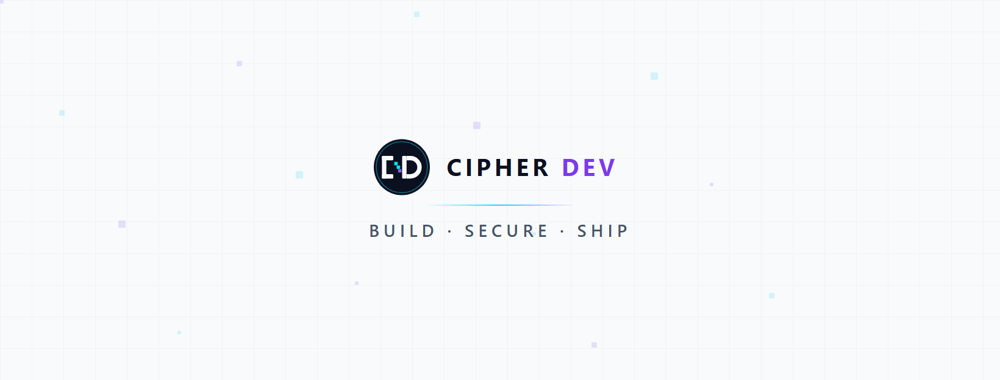

# Hi, I'm Cipher Dev N 👋

**Full-stack developer · CodeIgniter 4 · Next.js · MSSQL**

Building secure, clean, shippable software.

---

## 🧰 Tech stack

## 🚀 Featured projects

| Project | What it is | Links |
| --- | --- | --- |
| **CipherOke** | A free web app for song requests at parties, bars or at home. Create a room to get a song queue and a TV screen. Guests scan a QR code and request songs from their phones. Hosts can make table QR codes, and rooms stay open 1–12 hours. | [Live](https://iis.cipherclouddev.com/cipheroke/) · [How it works](https://iis.cipherclouddev.com/cipheroke/help) |

## 🔭 What I do

- 🧩 Domain-Driven Design: bounded contexts, entities, value objects and repositories modeled around the business domain
- 🔐 REST APIs with layered architecture (Filters → Controllers → Services → Repositories)
- 🗄️ MSSQL schema design with UUID keys, migrations and query tuning
- 🎨 Clean, responsive UIs in Next.js and Vue
- ⚙️ CI/CD with GitHub Actions and IIS reverse-proxy deployments

## 📊 GitHub stats

## 🤝 Let's work together

Open to freelance and collaboration. Reach me at **cipherdevn@gmail.com**.

<picture>
  <source media="(prefers-color-scheme: dark)" srcset="assets/logo-dark.svg">
  
</picture>

